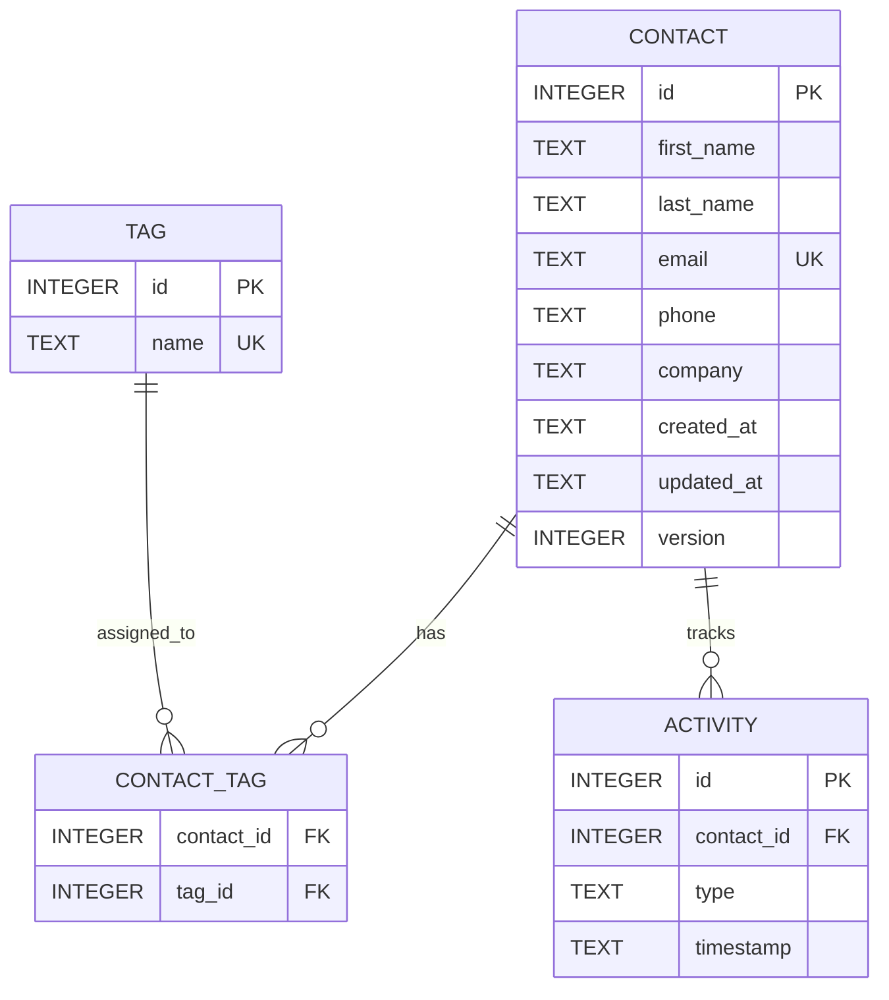

# CRM Contact Workspace

A full-stack, end-to-end CRM Contact Workspace built with **React 19**, **TypeScript**, **Redux Toolkit**, **Express**, and **SQLite**.

The workspace allows users to browse, search, filter, sort, paginate, view, and update contacts, manage and bulk-assign tags, and inspect an audit trail of contact activities. The architecture strictly enforces backend-driven querying, optimistic concurrency control, and transactional activity tracking.

---

## Table of Contents

1. [Architecture & System Design](#architecture--system-design)
2. [Tech Stack](#tech-stack)
3. [Data Model & Database Schema](#data-model--database-schema)
4. [API Contract & Endpoints](#api-contract--endpoints)
5. [Key Technical Decisions](#key-technical-decisions)
6. [Concurrent Update Approach](#concurrent-update-approach)
7. [Getting Started & Running Locally](#getting-started--running-locally)
8. [Automated Testing & Quality Checks](#automated-testing--quality-checks)
9. [Scale Considerations](#scale-considerations)
10. [AI Usage Disclosure](#ai-usage-disclosure)
11. [Known Limitations & Future Improvements](#known-limitations--future-improvements)
12. [Repository Navigation & Key Files](#repository-navigation--key-files)

---

## Architecture & System Design

```
┌────────────────────────────────────────────────────────┐
│                   Frontend Client                      │
│   React 19 + TypeScript + Redux Toolkit + Vite Proxy   │
│   • URL query state as single source of truth          │
│   • Optimistic concurrency conflict resolution UI       │
│   • Debounced search & responsive bulk tagging bar     │
└───────────────────────────┬────────────────────────────┘
                            │ HTTP JSON / REST (/api)
                            ▼
┌────────────────────────────────────────────────────────┐
│                   Backend API Server                   │
│         Express 4 + TypeScript + Zod Validation        │
│   • Consolidated GET /contacts query engine            │
│   • Atomic transactions for updates & activity logs    │
│   • Version-checked optimistic concurrency (409)       │
└───────────────────────────┬────────────────────────────┘
                            │ better-sqlite3 (WAL Mode)
                            ▼
┌────────────────────────────────────────────────────────┐
│                   SQLite Database                      │
│            Persistent storage: backend/data/crm.db     │
│   • contacts (version, email unique, indexes)          │
│   • tags & contact_tags (many-to-many junction)        │
│   • activities (audit trail: CONTACT_UPDATED, etc.)    │
└────────────────────────────────────────────────────────┘
```

- **High-Level Diagram**: Illustrated in [`docs/HLD.png`](docs/HLD.png).
- **Detailed Design Document**: Documented in [`docs/DESIGN.md`](docs/DESIGN.md).
- **Feature Specifications**:
  - Contact Management: [`docs/features/contact-management.md`](docs/features/contact-management.md)
  - Tag Management: [`docs/features/tag-management.md`](docs/features/tag-management.md)
  - Activity History: [`docs/features/activity-management.md`](docs/features/activity-management.md)
- **Requirements & Audit Checklist**: Complete verification breakdown in [`checklist.md`](checklist.md).

---

## Tech Stack

### Frontend
- **Framework**: [React 19](https://react.dev/) with TypeScript
- **Build Tool & Bundler**: [Vite 8](https://vitejs.dev/) with Babel plugin for [React Compiler](https://react.dev/learn/react-compiler)
- **State Management**: [Redux Toolkit (RTK)](https://redux-toolkit.js.org/) for server-state caching and async thunks
- **Routing**: [React Router v7](https://reactrouter.com/) (using URL search params for bookmarkable/shareable filter state)
- **Icons**: [Lucide React](https://lucide.dev/)
- **Linting**: ESLint 10 with `typescript-eslint`

### Backend
- **Runtime**: [Node.js](https://nodejs.org/) (ES Modules / TypeScript)
- **Framework**: [Express 4](https://expressjs.com/)
- **Database Engine**: [better-sqlite3](https://github.com/WiseLibs/better-sqlite3) (synchronous, high-performance C SQLite binding with WAL mode)
- **Validation**: [Zod](https://zod.dev/) for strict runtime request body parsing and error reporting
- **Development Tooling**: `tsx` (fast TypeScript execution with file watching)
- **Testing**: [Vitest](https://vitest.dev/) with [Supertest](https://github.com/ladjs/supertest)

---

## Data Model & Database Schema

The database is initialized in [`backend/src/db/database.ts`](backend/src/db/database.ts) with Write-Ahead Logging (`WAL`) and strict foreign key checks enabled.



### Table Definitions

1. **`contacts`**
   - `id`: `INTEGER PRIMARY KEY AUTOINCREMENT`
   - `first_name`: `TEXT NOT NULL`
   - `last_name`: `TEXT NOT NULL`
   - `email`: `TEXT NOT NULL UNIQUE` (case-insensitive checks enforced)
   - `phone`: `TEXT`
   - `company`: `TEXT`
   - `created_at`: `TEXT NOT NULL DEFAULT (datetime('now'))`
   - `updated_at`: `TEXT NOT NULL DEFAULT (datetime('now'))`
   - `version`: `INTEGER NOT NULL DEFAULT 1` (increments on every update for optimistic locking)
   - *Indexes*: `idx_contacts_email`, `idx_contacts_company`

2. **`tags`**
   - `id`: `INTEGER PRIMARY KEY AUTOINCREMENT`
   - `name`: `TEXT NOT NULL UNIQUE`

3. **`contact_tags` (Junction Table)**
   - `contact_id`: `INTEGER NOT NULL REFERENCES contacts(id) ON DELETE CASCADE`
   - `tag_id`: `INTEGER NOT NULL REFERENCES tags(id) ON DELETE CASCADE`
   - *Primary Key*: `(contact_id, tag_id)`

4. **`activities` (Audit History)**
   - `id`: `INTEGER PRIMARY KEY AUTOINCREMENT`
   - `contact_id`: `INTEGER NOT NULL REFERENCES contacts(id) ON DELETE CASCADE`
   - `type`: `TEXT NOT NULL CHECK (type IN ('CONTACT_UPDATED', 'TAG_ADDED', 'TAG_REMOVED'))`
   - `timestamp`: `TEXT NOT NULL DEFAULT (datetime('now'))`
   - *Indexes*: `idx_activities_contact_id`

---

## API Contract & Endpoints

All endpoints are served from the backend (port 5000) and mapped via Vite's proxy (`/api/*` $\to$ `/*`).

| Method | Endpoint | Description | Query / Body Payload | Status Codes |
|---|---|---|---|---|
| `GET` | `/contacts` | List, search, filter, sort, paginate contacts | Query: `page`, `limit`, `search`, `company`, `tag`, `sortBy`, `order` | `200` |
| `GET` | `/contacts/:id` | Get single contact with assigned tags | None | `200`, `404` |
| `PUT` | `/contacts/:id` | Update contact info with optimistic locking | Body: `{ firstName, lastName, email, phone, company, version }` | `200`, `400`, `404`, `409` |
| `POST` | `/contacts/:id/tags` | Add tag to contact (creates `TAG_ADDED` activity) | Body: `{ tagId }` | `201`, `400`, `404`, `409` |
| `DELETE` | `/contacts/:id/tags/:tagId` | Remove tag from contact (creates `TAG_REMOVED` activity) | None | `204`, `404` |
| `POST` | `/contacts/tags/bulk` | Bulk assign tag to contact IDs | Body: `{ contactIds: number[], tagId: number }` | `200`, `400`, `404` |
| `GET` | `/contacts/:id/activities` | Get chronologically ordered activity history | None | `200`, `404` |
| `GET` | `/tags` | List all available tags | None | `200` |
| `GET` | `/contacts/meta/companies` | List distinct companies for filter dropdown | None | `200` |

---

## Key Technical Decisions

1. **Consolidated Query Engine (`GET /contacts`)**:
   Instead of fragmenting search, filtering, sorting, and pagination across separate routes, all criteria are collapsed into a single parameterized SQL query in [`backend/src/services/contactService.ts`](backend/src/services/contactService.ts).
   - Backend computes total matched count and paginated page slices simultaneously.
   - Searching scans across `first_name`, `last_name`, full concatenated name, `email`, and `phone`.

2. **Optimistic Concurrency Control (OCC) over Locking**:
   Pessimistic locking requires maintaining long-lived database connections or distributed state. We implemented a clean OCC versioning model: each contact has an integer `version`. The update query matches on `WHERE id = ? AND version = ?`. If another user modified the contact in the interim, the version does not match, changes count is 0, and the server returns HTTP `409 Conflict` with `stale_update`.

3. **Transactional Integrity & Atomic Auditing**:
   Activities (`CONTACT_UPDATED`, `TAG_ADDED`, `TAG_REMOVED`) are recorded strictly inside the same SQLite transaction as the data change (using `db.transaction(...)`). If an update fails, no orphan activity row is inserted.

4. **URL as Single Source of Truth for List State**:
   Filter inputs, search terms, sorting direction, limit, and current page are stored directly in browser URL query parameters (`/contacts?search=john&tag=VIP&page=1`).
   - Enables browser back/forward history navigation.
   - Allows users to bookmark and share filtered views.

5. **React Compiler Optimization & Redux Architecture**:
   Configured with Vite's React Compiler plugin to automate component re-render optimization without blanket `useMemo`/`useCallback` clutter. Redux Toolkit manages server-side cached state, while transient inputs remain local to components.

---

## Concurrent Update Approach

### The Problem
Two users (User A and User B) load Contact #1 (currently at `version: 1`). User B submits an update and the contact advances to `version: 2`. When User A later submits an update with their stale copy, naive overwriting would erase User B's edits without warning.

### The Solution Flow

```
User A (loads v1) ──────────┐
                            │
User B (loads v1) ────┐     │
                      │     │
                      ▼     │
User B submits PUT (version: 1)
  └─► DB: WHERE id=1 AND version=1 ──► MATCH!
      Updates row, increments to version=2
      Records CONTACT_UPDATED activity
      Returns 200 OK (v2)
                            │
                            ▼
User A submits PUT (version: 1)
  └─► DB: WHERE id=1 AND version=1 ──► MISMATCH (Current is v2)
      0 rows affected!
      Rolls back transaction
      Returns HTTP 409 Conflict: { error: "stale_update" }
                            │
                            ▼
Frontend Client (User A):
  Catches 409 stale_update error
  Renders Amber Conflict Alert Banner:
  "This contact was modified by another user since you loaded it."
  Provides [Reload Latest Version] button
```

- **Backend Handler**: Implemented in [`backend/src/services/contactService.ts`](backend/src/services/contactService.ts#L161-L229).
- **Frontend Alert & Reload**: Implemented in [`frontend/src/components/ContactDetail/ContactDetailPage.tsx`](frontend/src/components/ContactDetail/ContactDetailPage.tsx#L461-L482).

---

## Getting Started & Running Locally

### Prerequisites
- **Node.js** >= 18.0.0
- **npm** >= 9.0.0

### 1. Clone & Install Dependencies

```bash
# Clone the repository
git clone <your-repo-url>
cd crm-contact-workspace

# Install backend dependencies
cd backend
npm install

# Install frontend dependencies
cd ../frontend
npm install
cd ..
```

### 2. Seed the Database

The database seeds automatically on server startup if empty, or you can run the standalone seed script:

```bash
cd backend
npm run seed
```
This populates 15 diverse contacts across tech companies (Google, Apple, Microsoft, Amazon, Meta, Stripe, Netflix) with varied tags, phones, and initial activity logs.

### 3. Run the Development Servers

Open two terminal tabs:

**Terminal 1 — Backend API Server:**
```bash
cd backend
npm run dev
# Starts Express server on http://localhost:5000 (with tsx hot-reload)
```

**Terminal 2 — Frontend Application:**
```bash
cd frontend
npm run dev
# Starts Vite client on http://localhost:5173
```

Open your browser and navigate to: **`http://localhost:5173`**

### 4. Build for Production

```bash
# Compile backend TypeScript to dist/
cd backend
npm run build
npm start

# Compile frontend bundle
cd ../frontend
npm run build
npm run preview
```

---

## Automated Testing & Quality Checks

### Backend Automated Tests
Backend tests use **Vitest** and **Supertest** running against an isolated database:

```bash
cd backend
npm test
```

**Test Coverage Summary (31 tests in 3 suites):**
- [`backend/tests/contacts.test.ts`](backend/tests/contacts.test.ts) (15 tests):
  - Paginated listing with custom `page` and `limit`.
  - Multi-field search (`?search=john`).
  - Company filter (`?company=Google`) and Tag filter (`?tag=VIP`).
  - Sort by name and sort by creation date.
  - Detail lookup and 404 handling.
  - Successful contact update with version increment and activity emission.
  - Optimistic concurrency rejection (HTTP 409 `stale_update`).
  - Duplicate email collision rejection (HTTP 409 `email_conflict`).
  - Zod request body validation (HTTP 400).
- [`backend/tests/tags.test.ts`](backend/tests/tags.test.ts) (8 tests):
  - List all tags.
  - Add tag with duplicate protection (409) and activity creation.
  - Remove tag with 404 handling and activity creation.
  - Bulk tag assignment with transaction rollback on invalid tag.
  - Correct reporting of `assigned` vs `skipped` counts.
- [`backend/tests/activities.test.ts`](backend/tests/activities.test.ts) (8 tests):
  - Chronological ordering (newest first).
  - Activity generation on contact update, tag addition, and tag removal.
  - Atomicity: no activity recorded if an update returns 409 conflict.

### Frontend Lint & Compilation
```bash
cd frontend
npm run lint    # ESLint check (0 errors)
npm run build   # Type-check and production bundle build
```

---

## Scale Considerations

If this application were expanded to support **millions of contacts per account**, **millions of daily updates**, and **thousands of simultaneous users**, the following architectural changes would be implemented:

### 1. Database Indexing & Query Strategy
- **Composite B-Tree Indexes**: Current SQLite indexes on `email` and `company` are adequate for small datasets. For millions of rows, add composite indexes such as `(company, created_at DESC)` and `(last_name, first_name)`.
- **Keyset / Cursor-Based Pagination**: Deep `OFFSET` queries (e.g. `OFFSET 500000 LIMIT 20`) degrade severely because the database must scan and discard all preceding rows. Transition to keyset pagination (`WHERE (created_at, id) < (:last_created_at, :last_id) ORDER BY created_at DESC LIMIT 20`), which executes in $O(\log N)$ time.
- **Dedicated Search Engine**: Searching `LIKE '%term%'` forces full table scans. At scale, integrate an inverted-index search engine such as **Elasticsearch**, **Meilisearch**, or PostgreSQL's **pg_trgm** / SQLite `FTS5` full-text search.

### 2. High-Throughput Write Operations & Updates
- **Asynchronous Activity Event Stream**: Contact updates currently write to `activities` within the same synchronous transaction. With millions of updates per day, emit events to an append-only distributed event bus (**Apache Kafka** or **AWS SQS**). A background worker consumes events and writes to an audit data warehouse (e.g. ClickHouse or BigQuery) without slowing down the primary update transaction.
- **Partitioning & Sharding**: Partition the `contacts` table horizontally by `account_id` (or tenant identifier) so high-volume accounts do not impact neighboring tenants.

### 3. Read Scalability & Caching
- **Read Replicas**: Separate reads and writes using Primary-Replica replication. All `GET /contacts` read queries route to read replicas, while writes go to the primary node.
- **Cache Layer**: Cache company metadata (`GET /contacts/meta/companies`) and available tags (`GET /tags`) in a distributed **Redis** cache with TTLs or cache-invalidation tags.

### 4. Concurrency & High Traffic
- **Stateless Backend Scale-Out**: Run multiple instances of the Express service containerized behind an Application Load Balancer (ALB) or NGINX reverse proxy.
- **Database Connection Pooling**: Utilize PgBouncer (or RDS Proxy) to manage pooling and avoid socket exhaustion under thousands of simultaneous connections.

---

## AI Usage Disclosure

In compliance with the assignment guidelines:

1. **Tool Used**: Google Antigravity (powered by Gemini models).
2. **What it was used for**:
   - Auditing the requirements checklist against [`docs/assignment.pdf`](docs/assignment.pdf).
   - Drafting and refining Vitest test suites for concurrency and edge cases.
   - Scaffolding type definitions and schema migrations between SQLite and TypeScript.
3. **One AI-Generated Suggestion Changed or Rejected**:
   - *Suggestion*: An early AI draft proposed executing search filtering in-memory on the frontend using Redux state after fetching an unpaginated collection of contacts.
   - *Why Changed / Rejected*: This directly violated the assignment requirement: *"Assume a production account may contain millions of contacts. Search, filtering, sorting, and pagination should be handled by the backend."* The recommendation was rejected, and a fully parameterized, SQL-backed filtering and pagination engine was implemented directly on the backend.

---

## Known Limitations & Future Improvements

- **Bulk Selection Scope**: The current UI selection operates on the currently loaded page view. For true enterprise workflows, adding a "Select all $N$ matching contacts across all pages" capability (backed by a server-side bulk query) would be beneficial.
- **Contact Creation / Deletion**: In accordance with the assignment focus on browsing, searching, filtering, updating, and tag/activity management, create and delete endpoints were not required and are not currently exposed.
- **SQLite Single-Writer Concurrency**: While SQLite in WAL mode allows multiple concurrent readers, it locks during writes. For multi-node cloud deployments, migrating to PostgreSQL with Prisma or Drizzle ORM would be the natural next step.

---

## Repository Navigation & Key Files

```
crm-contact-workspace/
├── AGENTS.md                          # Repository instructions & development rules
├── checklist.md                       # Comprehensive assignment verification checklist
├── docs/
│   ├── assignment.pdf                 # Original assignment specification
│   ├── DESIGN.md                      # Architecture, schema, and API route design
│   ├── HLD.png                        # High-level architecture diagram
│   └── features/                      # Detailed functional requirement specifications
│       ├── contact-management.md
│       ├── tag-management.md
│       └── activity-management.md
├── backend/
│   ├── src/
│   │   ├── app.ts                     # Express app setup, CORS, JSON middleware
│   │   ├── index.ts                   # Server entrypoint and DB auto-seed bootstrap
│   │   ├── types/index.ts             # Contact, Tag, Activity, and Pagination types
│   │   ├── db/
│   │   │   ├── database.ts            # SQLite connection, schema definition & indexes
│   │   │   └── seed.ts                # 15 seed contacts, tags, and activities
│   │   ├── routes/
│   │   │   ├── contacts.ts            # /contacts, /contacts/:id, /contacts/tags/bulk
│   │   │   ├── tags.ts                # /tags endpoint
│   │   │   └── meta.ts                # /contacts/meta/companies endpoint
│   │   └── services/
│   │       └── contactService.ts      # Core business logic, SQL queries, transactions
│   └── tests/                         # 31 automated Vitest tests
│       ├── contacts.test.ts
│       ├── tags.test.ts
│       └── activities.test.ts
└── frontend/
    └── src/
        ├── App.tsx                    # Routes, navigation layout, Redux Provider
        ├── api/contactsApi.ts         # Type-safe Fetch API client
        ├── store/
        │   ├── index.ts               # Redux store configuration
        │   └── contactsSlice.ts       # RTK slice, async thunks, selection state
        └── components/
            ├── ContactList/
            │   ├── ContactListPage.tsx # SearchParams sync, bulk toolbar, layout
            │   ├── ContactFilters.tsx  # Debounced search, dropdowns, sort controls
            │   ├── ContactTable.tsx    # Responsive table, skeletons, empty states
            │   └── Pagination.tsx      # Page buttons, limit selector
            └── ContactDetail/
                ├── ContactDetailPage.tsx # Detail view, optimistic conflict banner
                └── ActivityHistory.tsx   # Visual audit trail with relative timestamps
```
